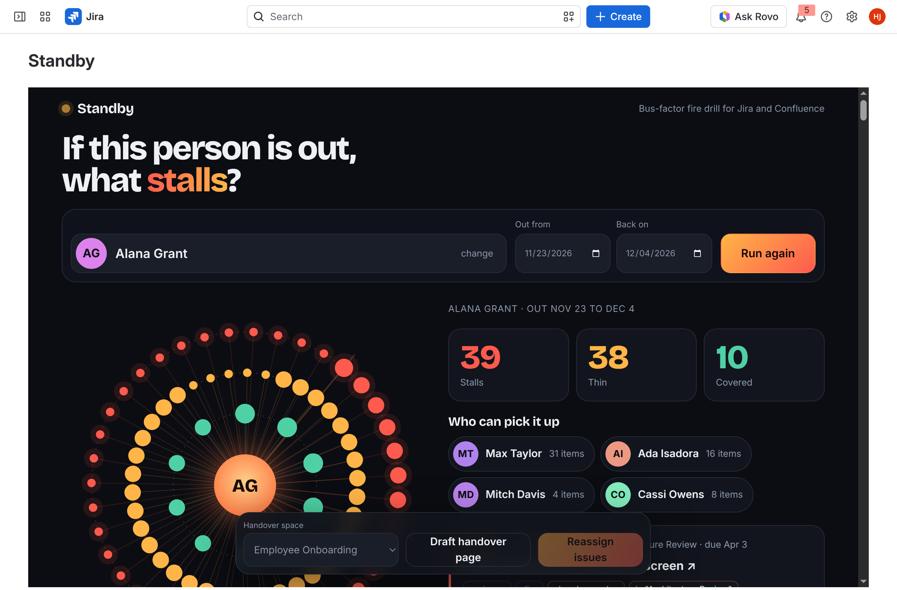

# Standby

**When a teammate takes leave, nobody knows which work will stall.**

Pick a teammate and their dates away. Standby shows who can cover each item,
suggests backups with reasons, and can draft a Confluence handover or reassign
selected Jira issues after confirmation.

## How it uses Atlassian

Forge hosts the Jira and Confluence app. Teamwork Graph finds the teammate's work
and colleagues who share it. Jira and Confluence REST add status, due dates, and
edit history. Queries run with the signed-in user's permissions.

## Quickstart

From a fresh clone with Node 22 or newer:

~~~sh
npm ci && npm run check
~~~

This builds the UI and runs the checks. A live drill needs a Forge development
install on Jira or Confluence. See [development and setup](docs/development.md).

[Video](https://youtu.be/7HAcyNG6KVs) · [Devpost](https://devpost.com/software/standby-ng4uxi) ·
[Privacy](PRIVACY.md)

This repository has no license file.
